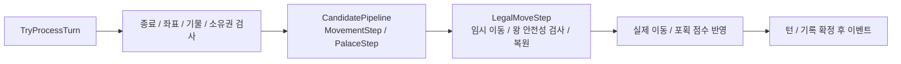

<h3 align="center">Tech Stack</h3>

<p align="center">
  
  
  
  
  
</p>

<p align="center">
  C# 9 / .NET 10 / .NET Standard 2.1 / MSTest<br />
  NuGet / UPM / npm / PowerShell / GitHub Actions
</p>

# YuJanggi.Engine

Unity 클라이언트와 .NET 서버가 공유하는 C# 장기 규칙 / 대국 상태 라이브러리입니다.
Unity 의존성 없이 보드 / 이동 검증 / 턴 / 점수 / 기보를 처리하고, 결과를 이벤트로 제공합니다.

## Highlights

- **공용 규칙 구현**: Unity의 대국 진행과 서버의 이동 검증에 같은 Engine 사용
- **합법 이동 판정**: 기물별 이동과 궁성 규칙으로 후보를 만든 뒤 자기 왕의 안전성을 검사
- **턴 결과 확정**: 이동 / 포획 / 점수 / 차례 / 기록을 반영한 후 TurnData로 결과 전달
- **기록과 복원**: 무르기로 보드와 점수 / 차례를 복원하고, Replay 탐색 위치와 최신 기록을 구분
- **AI 탐색 지원**: 실제 대국과 분리된 복제 보드에서 합법 수 조회 / 후보 적용 / 복원 API 제공

## 설치

[프로젝트](src/YuJanggi.Engine.csproj)는 `net10.0` / `netstandard2.1`을 대상으로 합니다.
[UPM 패키지](upm/package.json)의 최소 Unity 버전은 **6000.0**입니다.

### .NET / NuGet

GitHub Packages 읽기 인증을 설정한 뒤 소비 프로젝트에서 설치합니다.
아래 예시는 Unity / Server가 참조하는 **2.8.4** 버전 기준입니다.

```bash
dotnet add package YuJanggi.Engine --version 2.8.4 --source https://nuget.pkg.github.com/SeokJinYoo98/index.json
```

### Unity / UPM

Project Settings → Package Manager에서 Scoped Registry를 등록합니다.

- **Name**: `YuJanggi`
- **URL**: `https://registry.npmjs.org`
- **Scope**: `com.yujanggi`

Package Manager의 My Registries에서 **YuJanggi Engine**을 설치합니다.
패키지 ID는 `com.yujanggi.engine`입니다.

[GitHub Releases](https://github.com/SeokJinYoo98/YuJanggi.Engine/releases)에서도 `.nupkg` / `.tgz`를 제공합니다.
UPM 생성 소스는 Git에서 제외하므로, npm 또는 생성된 패키지를 사용합니다.

## 사용 예시

```csharp
using YuJanggi.Engine.Domain;
using YuJanggi.Engine.JanggiEngine;
using YuJanggi.Engine.JanggiOption;

var engine = JanggiEngineFactory.CreateEngine(
    new JanggiOptions { TurnTime = 60f });

engine.BindEvents();
engine.InitEngine();
engine.StartEngine();

bool accepted = engine.TryProcessTurn(
    new Pos(0, 3), new Pos(0, 4));

// 소비 프로젝트의 게임 루프에서 Tick(deltaTime)을 호출합니다.
// 대국을 정리할 때:
engine.EndEngine();
engine.UnBindEvents();
```

`InitEngine`은 초기 기물 배치를 구성하고, `StartEngine`은 기록 / 점수 / 차례와 타이머를 초기화합니다.
`Tick(deltaTime)`으로 시간을 진행하며, 제한시간이 끝나면 한 수 쉼으로 턴을 완료합니다.

### 공개 API

[IJanggiEngine과 관련 인터페이스](src/JanggiEngine/JanggiEngineInterfaces.cs)를 통해 명령과 조회를 구분합니다.

- **`TryProcessTurn(from, to)`**: 현재 차례의 합법 이동을 적용하고 성공 여부 반환
- **`ControllerQuery`**: 현재 차례 / 선택할 기물의 유효성 / 합법 및 불법 이동 위치 조회
- **`References`**: 읽기 전용 보드 / 턴 / 점수 / 기록과 GameEvents 참조
- **`ReplayRecord`**: Replay 진입과 종료 / 인덱스별 TurnData 조회
- **`Undo()` / `HandleHandicap()` / `GiveUp(team)`**: 무르기 / 한 수 쉼 / 지정 진영의 기권 처리
- **`CreateAIPosition()`**: AI 탐색용 복제 보드 생성

`References.GameEvents.OnTurnCompleted`는 턴 완료 후 `TurnData`, `OnUndoCompleted`는 복원 후 `UndoData`를 제공합니다.
장군 / 장군 해제 / 대국 결과도 TurnData에 포함하며, 외부에서 구독한 이벤트는 소비 프로젝트에서 해제합니다.

## 규칙 처리 구조

아래는 검사를 통과한 이동의 처리 흐름입니다.



- **[MovementStep](src/JanggiRule/Steps/MovementStep.cs)**: 기물별 이동 패턴과 경로를 바탕으로 후보 생성
- **[PalaceStep](src/JanggiRule/Steps/PalaceStep.cs)**: 궁성 내부 이동 규칙 적용
- **[LegalMoveStep](src/JanggiRule/Steps/LegalMoveStep.cs)**: 후보를 임시 적용해 자기 왕의 장군 여부를 확인하고 finally에서 보드 복원

[CandidatePipeline](src/JanggiRule/CandidatePipeline.cs)은 후보 생성, [JanggiRule](src/JanggiRule/JanggiRule.cs)은 최종 합법성 판정을 담당합니다.
거절된 이동은 실제 대국의 보드 / 차례 / 점수 / 기록을 변경하지 않습니다.

규칙 계산은 인스턴스의 작업 메모리를 재사용합니다.
소비 프로젝트는 동일 Engine 또는 AIPosition 인스턴스를 동시에 호출하지 않도록 순서를 관리해야 합니다.

## 대국 상태 / 기보

[JanggiEngine](src/JanggiEngine/JanggiEngine.cs)이 Board / Rule / Turn / Record / Score를 조정합니다.

- **턴 완료**: 이동과 점수를 반영하고, 차례 전환 또는 종료 후 기록을 추가한 뒤 결과 알림
- **한 수 쉼**: 기물을 이동하지 않고 턴 기록 추가와 차례 전환
- **무르기**: 마지막 기록을 제거하고 보드 / 포획 점수 / 차례를 복원한 뒤 UndoData 전달. 종료된 대국에서는 수행하지 않음
- **기보 탐색**: Replay 중 기록을 추가해도 탐색 위치를 유지하며, ExitReplay에서 최신 기록으로 복귀

실제 보드의 과거 수순 표시와 Live / Replay UI 전환은 Unity가 담당합니다.
Engine의 ReplayRecord는 기록과 탐색 위치를 관리합니다.

### 종료 처리

현재 Engine은 상대 진영의 합법 이동이 없으면 CheckMate 결과를 생성하며, `GiveUp`은 지정 진영의 기권 결과를 기록합니다.
Draw / Score는 결과 타입에 정의되어 있지만 현재 Engine 내부에 해당 종료 판정은 구현되어 있지 않습니다.

`EndEngine()`은 외부에서 확정한 종료를 반영해 시간 진행을 멈춥니다.
결과 생성 / 기록 추가 / 턴 완료 이벤트는 발생시키지 않습니다.

## AI 탐색 지원

[AIPosition](src/JanggiEngine/AIPosition.cs)은 생성 시점의 대국 보드를 복사합니다.

- **조회**: 기물 / 궁성 / 장군 여부와 진영별 합법 이동 목록
- **탐색**: `DoMove`로 후보를 적용하고 `UndoMove`로 복원
- **분리**: 탐색 중 실제 대국의 보드 / 턴 / 점수 / 기록은 진행하지 않음

수 선택 전략과 평가 함수 / Minimax 탐색은 Unity 소비 프로젝트에 구현되어 있습니다.
Engine은 복제 보드와 규칙 조회 API를 제공합니다.

## CI/CD

- **[CI](.github/workflows/ci.yml)**: `main` / `release/**` 대상 PR에서 Restore → Release Build → MSTest
- **[Release](.github/workflows/package-release.yml)**: `v*.*.*` 태그에서 버전 적용 → 빌드와 테스트 → NuGet / UPM 패키징 → Artifact 업로드 및 GitHub Release 생성
- **[CD](.github/workflows/cd.yml)**: 성공한 Release 실행의 `.nupkg` / `.tgz`를 GitHub Packages / npm에 발행

CD는 Release의 정확한 커밋과 같은 실행의 Artifact를 사용하며 패키지를 다시 빌드하지 않습니다.
npm 발행에는 Trusted Publishing을 사용합니다.

### 스크립트 역할

- **[SetVersion.ps1](scripts/SetVersion.ps1)**: Version.cs / .csproj / upm/package.json의 버전을 통일
- **[Prepare-Upm.ps1](scripts/Prepare-Upm.ps1)**: 실제 Compile 소스를 Runtime/Generated로 복사하고 경로 기반 고정 GUID의 .meta 생성
- **[BuildPackage.bat](scripts/BuildPackage.bat)**: dotnet pack으로 `.nupkg` 생성 → Prepare-Upm 실행 → npm pack으로 `.tgz` 생성
- **[Publish-Upm.ps1](scripts/Publish-Upm.ps1)**: 생성된 `.tgz`를 npm에 발행. 정식 버전은 latest, 사전 배포 버전은 next 태그 사용
- **[LocalPackage.bat](scripts/LocalPackage.bat)**: Target / Version을 입력받아 SetVersion과 BuildPackage 실행
- **[Read-WorkflowConfig.ps1](scripts/Read-WorkflowConfig.ps1)**: [workflowConfig.json](workflowConfig.json)의 대상 / 솔루션 경로 / 도구 버전 / Artifact 이름을 Workflow에 전달

로컬 패키징에는 .NET 10 SDK / Node.js와 npm / PowerShell이 필요합니다.
Windows에서 `scripts/LocalPackage.bat`을 실행하고 Target에는 `Engine`, Version에는 원하는 버전을 입력합니다.
버전 파일이 변경되며, 결과는 `artifacts/nuget` / `artifacts/upm`에 생성됩니다.

main에 기록된 버전은 **2.8.3**이며 Release 패키지는 태그 버전을 적용합니다.
Runner의 버전 변경과 생성 소스는 저장소에 자동 커밋하지 않습니다.
UPM 생성 소스는 직접 수정하지 않고 `src/`를 원본으로 유지합니다.

## 테스트

[YuJanggi.Engine.Tests](YuJanggi.Engine.Tests)에 다음 MSTest를 작성했습니다.

- **이동 규칙**: 기물별 경로 / 궁성 대각선 / 포의 넘기와 포획 제한 / 자기 왕을 노출하는 이동 거절
- **상태 보존**: 불법 이동과 상대 진영의 이동 거절 시 보드 / 차례 / 점수 / 기록 유지
- **턴 결과**: 포획 점수 / 장군 기록 / 한 수 쉼 / 기권 / 중복 BindEvents 시 시간 초과 턴의 단일 처리
- **무르기 / 재시작**: 포획과 한 수 쉼 복원 / 재시작 시 기록과 점수 초기화 / 타이머 경과 시간 초기화
- **이벤트 / 기보**: 알림 시점의 상태 일치 / Replay 커서 보정과 최신 기록 복귀

```bash
dotnet test YuJanggi.Engine.slnx --configuration Release
```

UI / 입력 / 네트워크 동기화와 AI 전략의 검증은 소비 프로젝트에서 수행합니다.

## 관련 프로젝트

- [YuJanggi.Unity](https://github.com/SeokJinYoo98/YuJanggi.Unity) — 화면 / 입력 / AI 전략 / Live와 Replay 표시
- [YuJanggi.Server](https://github.com/SeokJinYoo98/YuJanggi.Server) — 방별 Engine을 통한 이동 / 턴 / 결과 확정
- [YuJanggi.Protocol](https://github.com/SeokJinYoo98/YuJanggi.Protocol) — 클라이언트와 서버의 공용 메시지 계약
